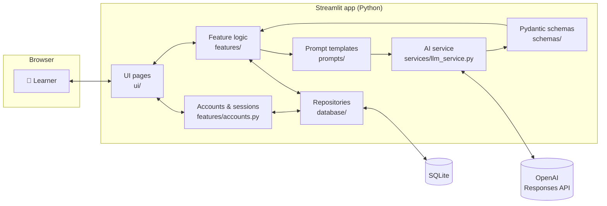
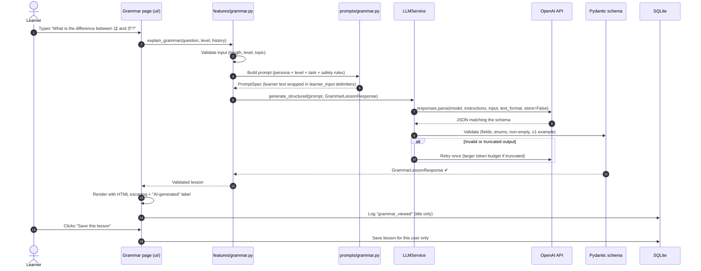
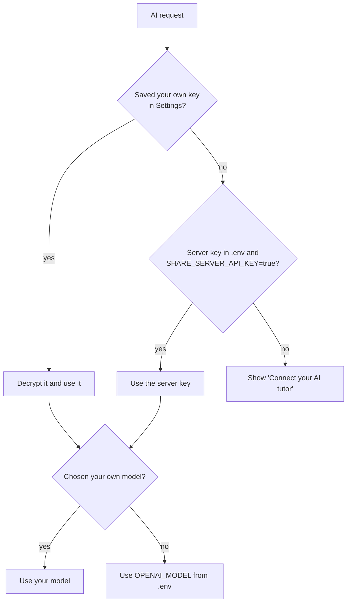
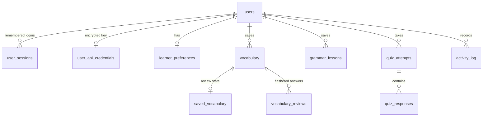

<div align="center">


<br>

### Learn Japanese with an AI tutor that *explains why*.

An AI-powered Japanese learning web app for English speakers, from your first ひらがな to natural, fluent conversation.

[](https://www.python.org/)
[](https://streamlit.io/)
[](https://platform.openai.com/docs)
[](https://docs.pydantic.dev/)
[](https://www.sqlite.org/)
[](https://plotly.com/python/)
[](#-testing--code-quality)
[](https://docs.astral.sh/ruff/)

**[App tour](#-app-tour)** · **[How it works](#-how-the-app-works)** · **[Tech stack](#-tech-stack)** · **[Setup guide](#-setup-guide)** · **[Configuration](#-configuration)** · **[Security](#-security--privacy)** · **[Deployment](#-deployment)**

<br>


<sub><i>The dashboard: study streak, word of the day, average score, recommended next step, and an activity timeline.</i></sub>

</div>

---

## 📖 Table of contents

1. [About the project](#-about-the-project)
2. [App tour (screenshots)](#-app-tour)
3. [How the app works](#-how-the-app-works)
4. [Tech stack](#-tech-stack)
5. [Setup guide (step by step)](#-setup-guide)
6. [Configuration](#-configuration)
7. [Project structure](#-project-structure)
8. [Database](#-database)
9. [Security & privacy](#-security--privacy)
10. [Testing & code quality](#-testing--code-quality)
11. [Deployment](#-deployment)
12. [Troubleshooting](#-troubleshooting)
13. [Limitations & roadmap](#-limitations--roadmap)
14. [Author](#-author)

---

## 🌸 About the project

**Japanese AI Tutor** is a complete, multi-user web application that uses a large language model as a personal Japanese teacher. You create an account, connect your OpenAI API key, and the app becomes:

- 📚 **A vocabulary builder** that creates topic word lists with readings, romaji and example sentences, then drills them with flashcards.
- 📝 **A grammar teacher** that answers any question in plain English, with patterns, examples and common mistakes.
- ✅ **A quiz master** offering seven question types. Answer keys stay hidden, and scoring is done by the app's own code.
- ✍️ **A writing coach** that corrects your Japanese sentences and separates real errors from style choices.
- 💬 **A conversation partner** that role-plays a restaurant, a shop or a train station with you.
- 📈 **A progress tracker** with your streak, scores and activity, all computed from real records.

### Why it is built this way

This is an **AI-engineering project**. The goal was not just to call an LLM, but to wrap it in reliable software:

| Principle | How it shows up in the code |
|---|---|
| **Structured, validated AI output** | Every model response is a Pydantic schema. Nothing is displayed or saved until it passes validation. |
| **Keep deterministic logic out of the model** | Quiz scoring, answer-key hiding, de-duplication and streaks are plain Python, so they are testable and can't be fooled by a hallucination. |
| **Treat AI output and user input as untrusted** | Prompt-injection delimiters, HTML escaping of every AI string, parameterized SQL, and strict input limits. |
| **Real multi-user security** | scrypt password hashing, login lockout, hashed session tokens, encrypted API keys, and per-user data isolation. |
| **Tested without spending money** | 208 automated tests with a mocked AI layer, including headless UI tests of sign-up, login, quizzes and settings. |

> ⚠️ All learning content is AI-generated and labelled as such in the app. It is usually helpful but **can contain mistakes**, so verify important points with a teacher, textbook or dictionary.

---

## 🖼 App tour

> All screenshots were captured from the running app with real AI responses (`gpt-5.4-mini`) and a fictional demo learner, Hana Sato.

### 1 · Welcome & sign in

<table>
<tr>
<td width="62%"></td>
<td width="38%">

**A proper front door.** Visitors see what the app does and can **log in** or **create an account** right away.

- Passwords need 8+ characters, with letters and numbers
- **Keep me signed in** remembers you for 14 days
- 5 wrong passwords lock the account for 10 minutes
- On phones, the login card moves to the top 👉

</td>
</tr>
</table>

<p align="center"><br><sub><i>Responsive mobile layout</i></sub></p>

### 2 · Dashboard

<table>
<tr>
<td width="38%">

**Your daily home screen.**

- A Japanese greeting that matches *your* local time (おはようございます / こんにちは / こんばんは)
- **Study streak**, saved words, quizzes and level
- **Word of the day**, picked from your own saved vocabulary
- An **average-score ring** and a **recommended next step** based on your real activity
- A recent-activity timeline and quick links to every feature

</td>
<td width="62%"></td>
</tr>
</table>

### 3 · Vocabulary 語

<table>
<tr>
<td width="62%"></td>
<td width="38%">

**Word lists for any topic.** Choose a preset topic or type your own (for example *"cooking verbs"*), pick your level and 3–15 words.

Each card shows:
- the word in **kanji**, with its **kana reading** and **romaji**
- the **meaning** and **part of speech**
- an **example sentence** with a translation
- a usage note when the nuance matters

**Save** individual words or the whole list. Duplicates are ignored automatically.

</td>
</tr>
</table>

<table>
<tr>
<td width="38%">

**Flashcard review.** The Japanese appears first; try to recall it, then reveal the answer and mark **I knew it** or **Still learning**.

Words you get wrong, or haven't reviewed yet, come back first next time. Every review counts towards your progress.

**My vocabulary** lets you search, filter and remove saved words, and start a **quiz built from your own words**, which needs no AI call at all.

</td>
<td width="62%"></td>
</tr>
</table>

### 4 · Grammar Tutor 文

<table>
<tr>
<td width="62%"></td>
<td width="38%">

**Ask anything, in English.** For example, *"What is the difference between は and が?"*

You get a structured mini-lesson:
- the **pattern** and **how to form it**
- a clear **explanation**
- **examples**, each labelled formal, casual or neutral
- **common mistakes**, shown as ❌ → ✅ with the reason
- **formal vs. casual** notes and **related patterns**

Ask **follow-ups** (the tutor remembers your last 3 questions), **save** lessons, or turn a lesson into a **practice quiz** with one click.

</td>
</tr>
</table>

### 5 · Quiz Center 試

<table>
<tr>
<td width="38%">

**Seven question types:** multiple choice, Japanese→English, English→Japanese, fill in the blank, sentence construction, vocabulary recall and grammar, plus **Mixed**.

- One question at a time, with Previous / Next and jump-to buttons
- **Answer keys never reach the page** until you submit
- A warning appears if questions are left unanswered
- AI questions that fail quality checks are discarded

</td>
<td width="62%"></td>
</tr>
</table>

<table>
<tr>
<td width="62%"></td>
<td width="38%">

**Fair, instant results.** The score is calculated **in Python, not by the AI**, and a quiz can never be scored or saved twice.

- 🟢 Correct answers and 🔴 your wrong choices are highlighted
- Every question has an explanation
- **Explain my mistake** gives a deeper AI explanation with an extra example
- **Show only questions I missed** for fast review
- Mistakes from all past quizzes stay available for review

</td>
</tr>
</table>

### 6 · Sentence Correction 直

<table>
<tr>
<td width="38%">

**Write Japanese and get honest feedback.** Optionally say what you meant and who you're talking to.

The tutor gives you:
- a **verdict**: correct, could be more natural, needs correction, or meaning unclear
- the **corrected sentence** with reading, romaji and translation
- each **issue**, rated *error*, *unnatural* or *optional*
- a **more natural alternative** and a **learning tip**
- any **assumptions** it made

It never marks a sentence wrong just because it is unusual or casual.

</td>
<td width="62%"></td>
</tr>
</table>

### 7 · Conversation Practice 話

<table>
<tr>
<td width="62%"></td>
<td width="38%">

**Role-play real situations.** Choose from 11 scenarios, including a restaurant, convenience store, train station, hotel, doctor and coworker.

- Your partner stays in character, at your level
- Optional **corrections** of each message you send
- **Romaji** on or off
- **English & notes** with the translation, vocabulary and a suggested reply
- **Explain this sentence** for a word-by-word breakdown

</td>
</tr>
</table>

### 8 · Learning Progress 進

<table>
<tr>
<td width="38%">

**See your growth.** Every number is computed from your stored records, never estimated:

- words saved, flashcard reviews, quizzes and average score
- grammar lessons viewed and saved, sentences checked, conversations started
- an interactive **quiz-score trend** and **30-day activity** chart
- **saved words by topic**
- the full **quiz history** and an activity timeline

</td>
<td width="62%"></td>
</tr>
</table>

### 9 · Settings ⚙️

<table>
<tr>
<td width="50%"></td>
<td width="50%"></td>
</tr>
<tr>
<td>

**AI setup:** paste your OpenAI key. It is verified with OpenAI, **encrypted**, and never shown again. **Load available models** lists the models your key can actually use; **Test model** confirms the one you pick works.

</td>
<td>

**Account:** update your name and email, change your password (this signs out your other devices), or permanently **delete your account** and all of its data. There are also tabs for **learning preferences** and **clearing data** by category.

</td>
</tr>
</table>

---

## ⚙️ How the app works

### The big picture



Each layer has one job, and dependencies only point one way:

| Layer | Folder | Job |
|---|---|---|
| **UI** | `app.py`, `ui/` | Draws pages, collects input, shows results. It never talks to OpenAI or SQL directly. |
| **Accounts** | `features/accounts.py`, `ui/session.py`, `core/security.py` | Sign-up, login, sessions, profile, deletion, encrypted API keys, and choosing each user's key and model. |
| **Feature logic** | `features/` | Validates input, builds the prompt, calls the AI, checks the result, scores quizzes, and saves data. It has no Streamlit code, so it can be unit-tested. |
| **Prompts** | `prompts/` | The tutor's persona, per-level guidance, safety rules, and one template per feature. |
| **AI service** | `services/llm_service.py` | The **only** code that calls OpenAI: structured outputs, retries, friendly error messages, model listing. |
| **Schemas** | `schemas/` | Pydantic models that describe and validate every AI response. |
| **Repositories** | `database/` | All SQL lives here (parameterized). Learning data is always filtered by the logged-in user. |

### What happens when you click "Explain Grammar"



### How a quiz stays fair

1. **Generation.** The AI writes the questions as structured JSON: options, the correct index and an explanation.
2. **Quality checks** (`features/quiz.py`). Questions are dropped if they have duplicate options, an out-of-range answer index, the wrong type, or repeat an earlier question.
3. **Shuffling.** Options are shuffled in Python, so the correct answer isn't always in the same position.
4. **Hidden answers.** The page renders only `public_questions()`, a view with **no answer index and no explanation**.
5. **Answering.** Your choices are stored on the quiz session, so switching pages doesn't lose them.
6. **Scoring.** `calculate_quiz_score()` compares your choices with the key in Python.
7. **Saving.** The attempt and every answer are saved in **one transaction**. A unique quiz id means repeated clicks or reloads can never create duplicates.

### Where your API key comes from



### Error handling

Every failure becomes a clear message; raw errors, tracebacks and keys never reach the browser.

| Situation | What the learner sees | Retried? |
|---|---|---|
| No key or model | A link to *Settings → AI setup* | — |
| Invalid key (401/403) | "The OpenAI API rejected the configured API key…" | No |
| Unknown model (404) | "The configured model was not found…" | No |
| Unsupported request (400/422) | "The model may not support structured outputs…" | No |
| Rate limit (429) | "Too many requests… wait a moment" | By the SDK |
| Out of credit (`insufficient_quota`) | "No remaining API quota… check billing" | No |
| Timeout / network / 5xx | "Could not reach the AI service…" | By the SDK |
| Invalid or truncated JSON | "The AI returned a response that could not be used…" | Once, by the app |
| Model refusal | "The AI declined to answer this request…" | No |

---

## 🧰 Tech stack

| | Technology | Version | Role in this project | Why it was chosen |
|---|---|---|---|---|
|  | **Python** | 3.11+ (tested on 3.12) | The whole application | Rich AI ecosystem, readable, strong typing (`X \| None`, `ParamSpec`) |
|  | **Streamlit** | 1.66 | Web UI, multipage navigation, session state, theming | Build a polished, interactive web app in pure Python; native `st.navigation`, keyed containers for custom CSS, `persist_state` widgets |
|  | **OpenAI Python SDK** | 3.35 | Calls the model through the **Responses API** | Official SDK; `responses.parse()` returns typed Pydantic objects; built-in retries and timeouts |
|  | **Pydantic** | 2.14 | Schemas for every AI response, plus validation | One class defines the JSON schema sent to the model *and* validates the reply |
|  | **SQLite** | bundled with Python | Users, sessions, vocabulary, lessons, quizzes, activity | Zero setup, a single file, transactional; the SQL is written to port to PostgreSQL |
| 🔐 | **cryptography** (Fernet) | 50 | Encrypts saved API keys | Audited, well-documented authenticated symmetric encryption |
| 🔑 | **hashlib.scrypt** | standard library | Password hashing | Memory-hard, salted and built in, so no extra dependency |
|  | **Plotly** | 7.1 | Interactive progress charts | Hover tooltips; integrates with `st.plotly_chart` |
| ⚙️ | **python-dotenv** | 1.2 | Loads `.env` for local development | Keeps secrets out of code and Git |
|  | **pytest** | 9.1 | 209 automated tests | Fixtures, parametrization, and Streamlit `AppTest` for headless UI tests |
|  | **Ruff** | 0.17 | Linting, formatting, security rules (`S`) | One fast tool replacing flake8, isort, black and bandit-style checks |
| 🎨 | **Google Fonts** | — | Plus Jakarta Sans (UI), Noto Sans JP / Noto Serif JP (Japanese) | Clean Latin typography and correct Japanese glyphs on every OS |

**Design system:** a Japanese-inspired palette: *shu-iro* vermilion `#C8372D`, *ai-iro* indigo `#2E4A7D`, sumi ink `#1C1E26`, and washi paper `#FBF8F3`. It also uses a *seigaiha* (青海波) wave pattern, a rising-sun kanji emblem on every page, and rounded cards with soft shadows. The theme lives in `.streamlit/config.toml` and component styles in `ui/styles.py`.

---

## 🚀 Setup guide

This guide assumes no prior setup. It takes about 10 minutes.

### Step 1 — Install Python 3.11 or newer

<details open>
<summary><b>🍎 macOS</b></summary>

1. Install [Homebrew](https://brew.sh) if you don't have it:
   ```bash
   /bin/bash -c "$(curl -fsSL https://raw.githubusercontent.com/Homebrew/install/HEAD/install.sh)"
   ```
2. Install Python and Git:
   ```bash
   brew install python@3.12 git
   ```
3. Check it worked:
   ```bash
   python3.12 --version     # Python 3.12.x
   ```
</details>

<details>
<summary><b>🪟 Windows</b></summary>

1. Download Python 3.12 from [python.org/downloads](https://www.python.org/downloads/).
2. Run the installer and **tick "Add python.exe to PATH"** on the first screen.
3. (Optional) Install Git from [git-scm.com](https://git-scm.com/download/win).
4. Open **PowerShell** and check:
   ```powershell
   py -3.12 --version       # Python 3.12.x
   ```
</details>

<details>
<summary><b>🐧 Linux (Ubuntu/Debian)</b></summary>

```bash
sudo apt update
sudo apt install python3 python3-venv python3-pip git fonts-noto-cjk
python3 --version          # must be 3.11 or newer
```
`fonts-noto-cjk` makes Japanese text display correctly.
</details>

### Step 2 — Get an OpenAI API key

1. Go to **[platform.openai.com](https://platform.openai.com)** and sign in (or create an account).
2. Open **Settings → Billing** and add a payment method or credit. *API usage is billed separately; a ChatGPT Plus subscription does **not** include API access.*
3. Open **[API keys](https://platform.openai.com/api-keys)** → **Create new secret key**, and copy the key (it starts with `sk-`).
4. Keep it private. You will paste it into the app's Settings page in Step 6.

> 💰 **Cost:** a typical request with a small model (for example a `-mini` model) costs a fraction of a cent. The app caps output length and sends only short histories.

### Step 3 — Download the project

**Option A: with Git**

```bash
git clone https://github.com/mohakamran/japanese-ai-tutor.git
cd japanese-ai-tutor
```

**Option B: as a ZIP (no Git needed)**

1. On the [repository page](https://github.com/mohakamran/japanese-ai-tutor), click the green **Code** button → **Download ZIP**.
2. Unzip it, then open a terminal *inside* the unzipped `japanese-ai-tutor` folder.

### Step 4 — Create a virtual environment and install dependencies

A virtual environment keeps this project's packages separate from the rest of your computer.

<details open>
<summary><b>🍎 macOS / 🐧 Linux</b></summary>

```bash
python3.12 -m venv .venv            # or: python3 -m venv .venv
source .venv/bin/activate           # your prompt now starts with (.venv)
pip install --upgrade pip
pip install -r requirements.txt
```
</details>

<details>
<summary><b>🪟 Windows (PowerShell)</b></summary>

```powershell
py -3.12 -m venv .venv
.venv\Scripts\Activate.ps1          # your prompt now starts with (.venv)
python -m pip install --upgrade pip
pip install -r requirements.txt
```
If PowerShell blocks the activate script, run `Set-ExecutionPolicy -Scope CurrentUser RemoteSigned` once, then try again.
</details>

### Step 5 — Create your configuration file

```bash
cp .env.example .env                # Windows: copy .env.example .env
```

For local use, **you don't need to edit anything**. The defaults work, and you can add your API key inside the app. All available settings are described under [Configuration](#-configuration).

> Optional: to give everyone on your machine a default key and model, open `.env` and fill in `OPENAI_API_KEY=` and `OPENAI_MODEL=`.

### Step 6 — Run the app

```bash
streamlit run app.py
```

Your browser opens **http://localhost:8501**. If it doesn't, open that address yourself.

**First-time use:**

1. Click **Create account**, then enter a display name, email and password.
2. Go to **Settings → AI setup**, paste your API key and click **Verify & save key**.
3. Click **Load available models**, pick a model, click **Save model**, then **Test model**. You should see ✅ *"structured outputs confirmed"*.
4. Open **Vocabulary**, choose a topic and click **Generate Vocabulary**. 🎉

### Everyday use

| Task | Command |
|---|---|
| Start the app | `source .venv/bin/activate` (Windows: `.venv\Scripts\Activate.ps1`), then `streamlit run app.py` |
| Stop the app | Press <kbd>Ctrl</kbd> + <kbd>C</kbd> in the terminal |
| Use a different port | `streamlit run app.py --server.port 8502` |
| Get updates | `git pull` then `pip install -r requirements.txt` |
| Run the tests | `pip install -r requirements-dev.txt` then `pytest` |
| Back up your data | Copy the `data/` folder (the database **and** `.app_secret_key`) |

---

## 🔧 Configuration

Every setting is optional. Real environment variables take precedence over `.env`, which takes precedence over Streamlit secrets.

| Variable | Default | What it does |
|---|---|---|
| `OPENAI_API_KEY` | — | Server-wide key for learners who haven't saved their own |
| `OPENAI_MODEL` | — | Default model when a learner hasn't chosen one |
| `SHARE_SERVER_API_KEY` | `true` | Allow signed-in users to use the server key. **Use `false` for public deployments** |
| `OPENAI_REASONING_EFFORT` | — | For reasoning models: `low` / `medium` / `high` (lower is cheaper and faster) |
| `OPENAI_TIMEOUT_SECONDS` | `60` | Per-request timeout (5–600) |
| `OPENAI_MAX_RETRIES` | `2` | SDK retries for rate limits, timeouts and 5xx errors (0–5) |
| `APP_SECRET_KEY` | auto-generated | Fernet key that encrypts saved API keys. If unset, it is created in `data/.app_secret_key` (mode 600). **Back it up** |
| `SESSION_DAYS` | `14` | Length of "Keep me signed in" (0 turns it off) |
| `ALLOW_SIGNUPS` | `true` | Set `false` to close registration |
| `APP_PASSWORD` | — | Optional site-wide password shown before the login page |
| `DATABASE_PATH` | `./data/japanese_tutor.db` | Where the SQLite database lives |
| `LOG_LEVEL` | `INFO` | `DEBUG`, `INFO`, `WARNING`, `ERROR` or `CRITICAL` |

Generate an `APP_SECRET_KEY`:

```bash
python -c "from cryptography.fernet import Fernet; print(Fernet.generate_key().decode())"
```

**If an API key leaks:** revoke it on the OpenAI platform, create a new one, and save it again in Settings. Deleting a committed key from Git does not make it safe; rotating it does.

---

## 🗂 Project structure

```text
japanese-ai-tutor/
├── app.py                     # Entry point: theme, login routing, navigation, sidebar
├── requirements.txt           # Runtime dependencies
├── requirements-dev.txt       # + pytest, ruff
├── pyproject.toml             # pytest + ruff configuration
├── .env.example               # Configuration template (no secrets)
├── .streamlit/
│   ├── config.toml            # Theme colours/fonts; error details hidden from users
│   └── secrets.toml.example   # Template for hosted deployments
├── assets/                    # Logo and icon (SVG)
├── config/
│   ├── settings.py            # Loads and validates all settings
│   └── logging_config.py      # Logging with secret redaction
├── core/
│   ├── constants.py           # Levels, topics, scenarios, quiz types, input limits
│   ├── errors.py              # Error classes with learner-safe messages
│   ├── validation.py          # Input validation
│   └── security.py            # scrypt hashing, Fernet encryption, session tokens
├── services/
│   └── llm_service.py         # OpenAI integration, model listing and testing
├── prompts/                   # base.py (persona + safety) + one template per feature
├── schemas/                   # Pydantic models for every AI response
├── features/
│   ├── accounts.py            # Sign-up, login, sessions, profile, deletion, API keys
│   ├── vocabulary.py          # Generate, save, flashcard deck
│   ├── grammar.py             # Lessons with bounded follow-up history
│   ├── quiz.py                # Generation, quality checks, shuffling, scoring, QuizSession
│   ├── correction.py          # Sentence correction
│   ├── conversation.py        # Role-play and sentence explanations
│   └── progress.py            # Stats, streak, word of the day, recommendations
├── database/
│   ├── connection.py          # Transactional connections
│   ├── initialization.py      # Forward-only migrations
│   ├── models.py              # Row dataclasses
│   └── repository.py          # AccountRepository + user-scoped LearningRepository
├── ui/
│   ├── auth_page.py           # Landing page with log-in / sign-up
│   ├── dashboard.py, vocabulary_page.py, grammar_page.py, quiz_page.py,
│   ├── correction_page.py, conversation_page.py, progress_page.py, settings_page.py
│   ├── components.py          # Escaped HTML components (cards, tiles, ring, timeline)
│   ├── styles.py              # Design-system CSS
│   ├── session.py             # Login state + "remember me" cookie
│   └── services.py, navigation.py, state.py, auth.py
├── tests/                     # 209 tests
├── docs/                      # Banner + screenshots used in this README
└── data/                      # Database + encryption key (created at runtime, git-ignored)
```

---

## 🗄 Database

SQLite is created automatically on first run and upgraded by numbered, **forward-only migrations**, so startup never deletes data. When an older single-user database is upgraded, the **first account created inherits its existing data**.



| Table | What it stores |
|---|---|
| `users` | Email (unique), display name, scrypt `password_hash`, failed-login counter, lock time |
| `user_sessions` | **SHA-256 hash** of each remember-me token, plus its expiry (the raw token is never stored) |
| `user_api_credentials` | The **Fernet-encrypted** API key and a hint such as `…abcd` |
| `learner_preferences` | Level, romaji, explanation style, difficulty, corrections, chosen model |
| `vocabulary`, `saved_vocabulary`, `vocabulary_reviews` | Saved words (unique per user), review counts, review history |
| `grammar_lessons` | Saved lessons as validated JSON |
| `quiz_attempts`, `quiz_responses` | Scores (with a unique quiz id, which blocks duplicates) and per-question answers |
| `activity_log` | Short descriptions for the dashboard. Your sentences and chat messages are **never** stored |

Every user-owned table uses `ON DELETE CASCADE`, so **deleting an account removes all of its data**.

**Not stored:** conversations, sentence-correction text, unsaved generated content, and raw AI responses.

---

## 🔒 Security & privacy

| Area | Protection |
|---|---|
| **Passwords** | scrypt (N=2¹⁴, r=8, p=1) with a random 16-byte salt and constant-time comparison |
| **Brute force** | 5 failed attempts lock the account for 10 minutes. The error message and timing are the same whether or not the account exists |
| **Sessions** | Random 256-bit tokens in a `SameSite=Strict` cookie (`Secure` on HTTPS). Only hashes are stored; tokens expire, are deleted on logout, and are revoked on password change |
| **API keys** | Verified with OpenAI, encrypted at rest, never displayed again, and cleared from form state after saving |
| **Data isolation** | Every learning query is filtered by the logged-in user. Tests prove users can't read, change, delete or hijack each other's records |
| **AI output** | Schema-validated, **HTML-escaped**, never executed; the model has no tools |
| **Prompt injection** | Learner text is wrapped in delimiters (embedded ones are stripped) and treated as data, never as instructions |
| **SQL injection** | Every query is parameterized, and a test fails if SQL is ever built with f-strings or concatenation |
| **Errors & logs** | No tracebacks in the browser. Logs redact `sk-…` keys, bearer tokens and configured secrets |
| **Provider privacy** | Requests use `store=False`; database contents are never sent to the model |

**Honest limitations:** there is no professional security audit, no email verification or password-reset email, and the cookie can't be `HttpOnly` because it is set from the page (all output is escaped to limit XSS). Always serve public deployments over HTTPS.

---

## 🧪 Testing & code quality

```bash
pip install -r requirements-dev.txt
pytest                                  # 208 pass, 1 skipped; no API key needed, costs nothing
RUN_LIVE_TESTS=1 pytest -m live         # optional: one real API call (uses .env)
ruff check . && ruff format --check .   # lint + formatting
```

| Test file | What it proves |
|---|---|
| `test_accounts.py` | Password hashing, sign-up rules, login lockout, sessions, profile and password changes, **account deletion cascade**, **cross-user isolation**, database upgrade, key encryption, model filtering |
| `test_quiz.py` | Deterministic scoring, invalid answers, hidden answer keys, no double submission, quality checks, shuffling |
| `test_llm_service.py` | Mocked OpenAI: request format, malformed, empty and truncated output, retry limits, every API error mapped safely |
| `test_database.py` | Migrations keep data, CRUD, transactions, cascades, friendly errors |
| `test_features.py` | Feature workflows with a fake AI, bounded histories, input limits |
| `test_security.py` | No secrets in logs, `repr` or source; HTML escaping; SQL parameterization |
| `test_app.py` | Headless browser-level tests: sign-up, login, logout, every page, API-key saving, quiz flow, error messages |

---

## ☁️ Deployment

### Streamlit Community Cloud (free)

1. Push this repository to your GitHub account.
2. Go to **[share.streamlit.io](https://share.streamlit.io)** → **Create app**, choose the repository, set **Main file** to `app.py`, and choose Python 3.11+.
3. Open **Advanced settings → Secrets** and paste:
   ```toml
   APP_SECRET_KEY = "your-generated-fernet-key"
   SHARE_SERVER_API_KEY = "false"   # each user brings their own OpenAI key
   ```
4. Click **Deploy**. HTTPS is automatic.

> ⚠️ Community Cloud storage is **temporary**: the database (including accounts) is wiped when the app restarts. That's fine for demos; for real users, self-host with a persistent disk or move to PostgreSQL (all SQL is in `database/`).

### Self-hosting

Run `streamlit run app.py --server.address 0.0.0.0` behind an HTTPS reverse proxy (Caddy or nginx). Set the configuration as environment variables, store `DATABASE_PATH` on a persistent, non-public disk, and back up the database together with `APP_SECRET_KEY`.

---

## 🩺 Troubleshooting

| Problem | Solution |
|---|---|
| "Connect your AI tutor" | Save a key and model in **Settings → AI setup** |
| "The OpenAI API rejected the configured API key" | The key is wrong or revoked. Create a new one and save it again |
| "Model was not found" / "rejected the request" | Pick a model from **Load available models** and click **Test model**. Remove `OPENAI_REASONING_EFFORT` for non-reasoning models |
| "No remaining API quota" | Add credit under Billing on platform.openai.com |
| "Too many requests" | Wait a minute and try again |
| "Saved API key could not be decrypted" | `APP_SECRET_KEY` changed; save your key again |
| "Account locked" | Wait 10 minutes |
| Logged out after refreshing | Tick **Keep me signed in** and allow cookies |
| `streamlit: command not found` | Activate the virtual environment first |
| "Port 8501 is already in use" | `streamlit run app.py --server.port 8502` |
| `pip install` fails | Make sure `python --version` shows 3.11+ *inside* the venv, run `pip install --upgrade pip`, and try again |
| Japanese shows as □ boxes | Install a Japanese font (Windows: add the Japanese language pack; Linux: `fonts-noto-cjk`) |
| "Configuration problem" on startup | A value in `.env` is invalid; the message names the variable |

---

## 🧭 Limitations & roadmap

**Current limitations:**
- AI content can be wrong; verify important points.
- Quizzes are multiple choice (deterministic scoring).
- No audio or pronunciation practice.
- Conversations aren't saved.
- Flashcard ordering is a heuristic, not true spaced repetition.

**Planned:**
- [ ] Spaced repetition (SM-2)
- [ ] Text-to-speech and pronunciation practice
- [ ] Typed answers with AI-assisted grading
- [ ] JLPT study paths and mock tests
- [ ] RAG over verified learning resources
- [ ] Password reset by email and OAuth sign-in
- [ ] PostgreSQL backend
- [ ] Anki export

---

## 👤 Author

**Muhammad Kamran** · [@mohakamran](https://github.com/mohakamran)

An AI-engineering portfolio project that combines LLM integration, structured outputs, secure multi-user web development, and a carefully designed learning experience.

If you find it useful, please ⭐ the repository!

### License

No license has been chosen yet, so all rights are reserved by the author. A `LICENSE` file will be added before the project is distributed as open source.

<div align="center">
<br>

**がんばって！** — *Keep going!*

</div>
